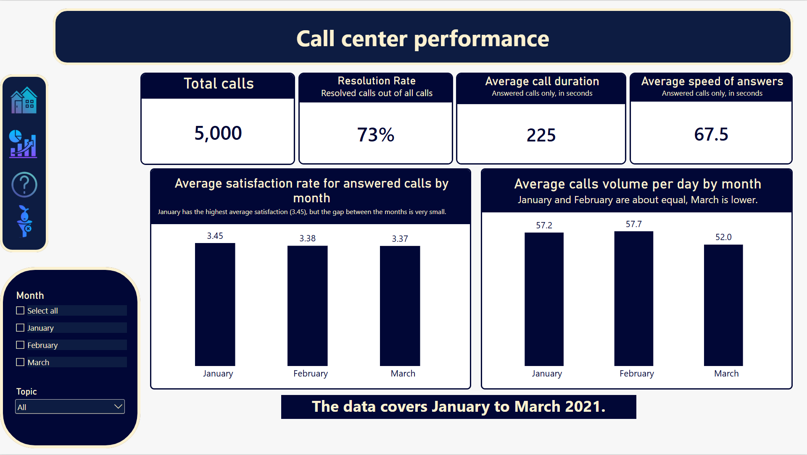
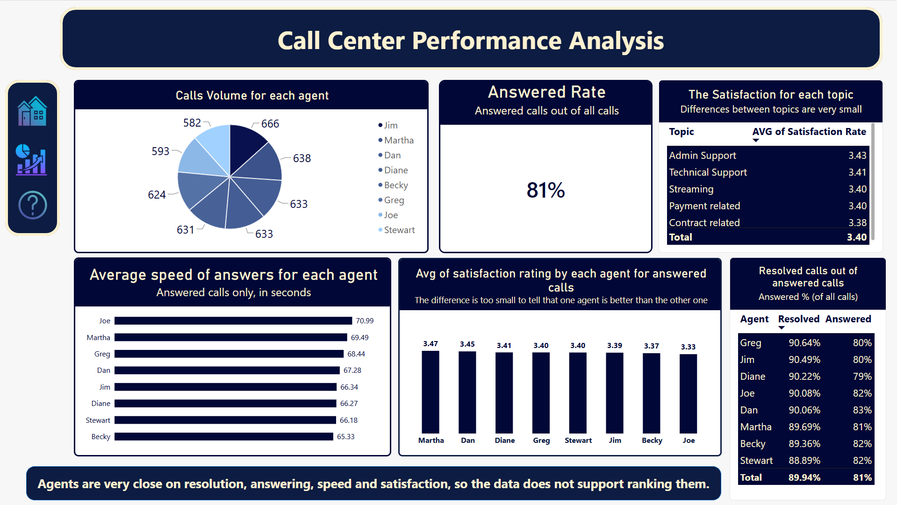
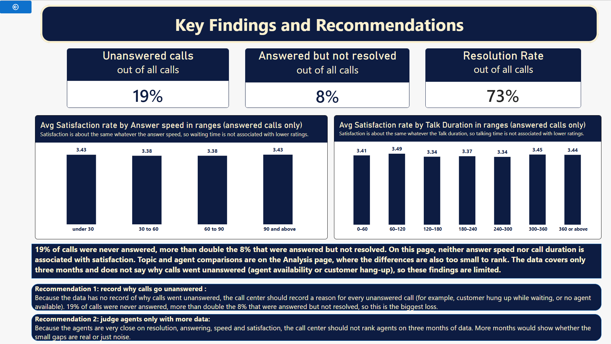

# Call Center Analytics Report (Power BI)

An interactive Power BI report that evaluates call center performance: how many calls are answered and resolved, how agents compare, and what is (and is not) associated with customer satisfaction.

> **Data note:** This project uses a public Kaggle dataset, not data from a real company. Findings describe this dataset only.


## How to Explore the Report

The screenshots below are static. To use the interactive version with filters and page navigation:

1. Click `call_center.pbix` in the file list above.
2. Click **Download raw file** (the download icon at the top right of the file page).
3. Open the downloaded file in Power BI Desktop (free, Windows only).
   
- Download the PDF preview: [call-center-report.pdf](https://github.com/AmrEyadALiMusleh/call-center-power-bi-analysis/raw/main/call-center-report.pdf)


## Business Questions

| # | Question | Answered on |
|---|----------|-------------|
| 1 | How many calls did the call center receive? | Overview |
| 2 | What percentage of calls were resolved? | Overview |
| 3 | How effectively does the call center answer incoming calls? | Analysis |
| 4 | What is the average answer speed? | Overview |
| 5 | What is the average call duration? | Overview |
| 6 | How do agents differ in call volume, resolution, answer speed and satisfaction? | Analysis |
| 7 | Which agents are strong and which need improvement? | Analysis |
| 8 | Which topics have the lowest satisfaction? | Analysis |
| 9 | What is associated with low satisfaction? | Key Findings |
| 10 | Which month had the highest call volume? | Overview |
| 11 | Which month had the highest average satisfaction? | Overview |
| 12 | What recommendations does the data support? | Key Findings |

---

## Dataset

- **Source:** Call Center dataset from Kaggle (https://www.kaggle.com/datasets/akash1vishwakarma/call-center-dataset).
- **Size:** 5,000 calls, January to March 2021 (90 days).
- **Columns:** Call Id, Agent, Date, Time, Topic, Answered (Y/N), Resolved, Speed of answer in seconds, AvgTalkDuration, Satisfaction rating.
- **Scale:** 8 agents, 5 topics, satisfaction rated 1 to 5.

---

## Data Preparation (Power Query)

| Step | What I did | Why |
|------|-----------|-----|
| Data types | Set Date to Date, Time to Time, text columns to Text, numeric columns to Whole Number | Power BI had left several columns untyped |
| Date check | Compared the earliest and latest dates with the expected range (1 Jan to 31 Mar 2021) | To confirm the day/month order was not swapped |
| Talk duration | Converted `AvgTalkDuration` (a time value) into seconds: minutes x 60 + seconds | A plain number can be averaged and compared with answer speed, which is also in seconds |
| Blank values | **Kept as null** for unanswered calls | An unanswered call has no answer speed, no talk time and no rating. Replacing them with 0 would distort every average |
| Answer speed ranges | Conditional column: under 30, 30 to 60, 60 to 90, 90 and above (seconds) | To test whether waiting time is associated with satisfaction |
| Duration ranges | Conditional column in 60-second bins, with a final "360 or above" bin | A smaller last bin held only 6 calls, so I merged it into "360 or above" |
| Sort order | Added a numeric sort column for the ranges | Text labels sort alphabetically and would hide the true order |
| Helper columns | Hidden `Minutes` and `Seconds` columns used for the conversion | Keeps the field list clean |

**Data quality findings**
- No duplicate Call Ids.
- All 946 blank values in speed, duration and rating belong to unanswered calls. They are "not applicable", not missing data.
- Unanswered calls still carry an agent name and a Resolved value of "N". The "N" is a consequence of the call not being answered, not a measured outcome.

**Other preparation notes**
- **Format vs type:** the Date column loaded showing the day name. That is only a display format, so I changed the format and kept the Date data type. Dates are day/month/year (for example 03/01/2021 is 3 January), confirmed by values such as 21/03/2021.
- **Time column:** it loaded with a placeholder date (12/31/1899) attached. I set it to the Time type so only the time of day remains. I kept the column although none of the 12 questions needs it.
- **Boundary bug:** a speed of exactly 90 seconds landed in the wrong bin. I fixed the condition so 90 falls in "90 and above", and checked that the totals across bins still equal 4,054 answered calls.
- **Y/N columns:** `Answered (Y/N)` and `Resolved` are kept as text, so DAX filters use "Y" and "N". This keeps visuals simple (Y/N instead of TRUE/FALSE).
- **Months:** month names come from the Date hierarchy and sort in calendar order.
- **Explicit measures:** every KPI is a DAX measure I wrote, not a drag-and-drop automatic average. Measures can be reused on every page and their logic can be checked.

---

## KPI Definitions

| KPI | Definition | Denominator |
|-----|------------|-------------|
| Total Calls | Count of Call Id | Not applicable |
| Answered Rate | Answered calls / total calls | All calls |
| Unanswered Rate | Unanswered calls / total calls | All calls |
| Resolution Rate | Resolved calls / total calls | **All calls** |
| Resolution Rate for Agents | Resolved calls / answered calls | **Answered calls** |
| Answered but Not Resolved Rate | Answered calls with Resolved = N / total calls | All calls |
| Average Speed of Answer | Average of answer speed in seconds | Answered calls only (blanks ignored) |
| Average Talk Duration | Average of talk duration in seconds | Answered calls only (blanks ignored) |
| Average Satisfaction | Average rating (1 to 5) | Answered calls only (blanks ignored) |
| Calls per Day | Total calls / number of days in the period | Days with calls |

### Why two resolution rates?

- **Resolution Rate (all calls)** answers "What percentage of calls were resolved?" Every caller counts, including customers who were never answered. Using answered calls here would make the call center look better than it was.
- **Resolution Rate for Agents (answered calls)** answers "How well does an agent solve problems once they pick up?" The data does not say why a call went unanswered, so counting those calls against an agent's problem-solving score would rest on a guess.

The three numbers below add up to 100% of calls: **73% resolved + 19% never answered + 8% answered but not resolved**.

### Why calls per day?

January and March have 31 days and February has 28, so total calls are not a fair comparison between months. Dividing each month's calls by its own number of days puts the months on the same scale.

### Why not divide satisfaction, speed or duration by days?

Calls per day needs the division because a **total** grows with the length of the period. An **average** (a rating, a speed, a duration) is already a per-call number, so a 28-day month and a 31-day month can be compared directly. Rule used: divide by time only when the starting number is a total that grows with time.

### Why are some averages "answered calls only"?

Answer speed, talk duration and satisfaction exist only for answered calls. Power BI's `AVERAGE` ignores blanks, so each of these averages covers answered calls only, and every title says so. Check: the count of satisfaction ratings is 4,054, which equals 5,000 calls minus 946 unanswered calls.

### Why unanswered does not mean "no problem"

A customer who called and was never answered still had a problem. It was never handled. That is why Resolution Rate divides by all calls, and why "answered but not resolved" (an agent tried) is kept separate from "never answered" (nobody tried).

---

## DAX Measures

```dax
Total Calls = COUNT(Sheet1[Call Id])

Answered Calls = CALCULATE([Total Calls], Sheet1[Answered (Y/N)] = "Y")

Resolved Calls = CALCULATE([Total Calls], Sheet1[Resolved] = "Y")

Answered Rate = DIVIDE([Answered Calls], [Total Calls])

Unanswered Rate =
DIVIDE(
    CALCULATE([Total Calls], Sheet1[Answered (Y/N)] = "N"),
    [Total Calls]
)

Resolution Rate = DIVIDE([Resolved Calls], [Total Calls])

Resolution Rate for Agents = DIVIDE([Resolved Calls], [Answered Calls])

Answered but Not Resolved Rate =
DIVIDE(
    CALCULATE([Answered Calls], Sheet1[Resolved] = "N"),
    [Total Calls]
)

Average Speed of Answer = AVERAGE(Sheet1[Speed of answer in seconds])

Average Talk Duration = AVERAGE(Sheet1[AvgTalkDuration in seconds])

Average Satisfaction = AVERAGE(Sheet1[Satisfaction rating])

Days = COUNTROWS(DISTINCT(Sheet1[Date]))

Calls per Day = DIVIDE([Total Calls], [Days])
```

**Notes**
- `DIVIDE` is used for every ratio because it returns a blank instead of an error or infinity when the denominator is zero.
- `AVERAGE` ignores blanks, which is why unanswered calls do not need special handling in the three averages.
- `Days` counts the distinct dates that appear in the data. This is correct only if every calendar day has at least one call, which I checked for this dataset (all 90 days have calls).

---

## Report Pages

### 1. Home
Cover page with navigation to the other pages.


### 2. Overview: "Call center performance"


Four KPI cards (total calls, resolution rate, average call duration, average speed of answer), plus average satisfaction by month and average calls per day by month. A month slicer and a topic slicer filter the page.

### 3. Analysis: "Call Center Performance Analysis"


Agent comparison: call volume, average speed of answer, average satisfaction, and a table with resolution rate (answered calls) and answer rate per agent. Also the overall answered rate and satisfaction by topic.

### 4. Key Findings and Recommendations


Breakdown of where calls are lost, tests of whether answer speed or call duration is associated with satisfaction, a summary of conclusions, and two recommendations.

---

## Report Design and Chart Decisions

**Page jobs**
- Overview answers "what happened?", Analysis answers "where and who?", and Key Findings tests what might explain the results and gives recommendations.

**Overview cards**
- Total Calls (volume), Resolution Rate and Average Speed of Answer (quality), and Average Call Duration. Answer Rate sits on the Analysis page, where Q3 is answered. Trade-off: the 73% on Overview does not show why it is not higher, so the Key Findings page splits the missing 27% into never answered (19%) and answered but not resolved (8%).

**Chart choices**
- **Calls per day (bar chart) instead of a pie:** averages do not add up to a meaningful total, so slices would not be parts of a whole. A pie is used only for call volume per agent, where the eight values are parts of the 5,000 calls.
- **Bars start at zero**, so bar lengths are honest. Exact values come from data labels with **two decimals**, because one decimal hid real gaps (for example 3.47 vs 3.33).
- **Ranges are sorted in range order**, not by value, so the chart does not show a false step-down.
- **Every title or subtitle states which calls the number covers** (all calls, or answered calls only).

**Tried and removed**
- A **bubble chart** for agent resolution: the values (88.9% to 90.6%) were too close to show with size or position.
- An **unanswered-rate-by-agent chart**: it carried the same information as answer rate (unanswered = 100% minus answered).
- A duplicate **agent speed pie chart**, and the agent speed chart on Overview (it answers Q6, so it moved to Analysis).

**Slicers**
- Agent slicer **removed from Overview**: selecting one agent turned the page into an agent report.
- Month slicer **kept on Overview**: the cards respond to it. Trade-off: the two month charts show one bar when one month is selected.
- Month slicer **removed from Analysis** after an incident: February was unselected by accident, the page showed 3,384 calls instead of 5,000, and nothing on the page showed it (the answered rate still read about 81%).
- Agent slicer **kept on Analysis**: every visual shows one agent's profile when it is used. Trade-off: the comparison charts show a single bar.

---

## Validation Checks

| Check | Result |
|-------|--------|
| Total calls | 5,000 |
| Calls per month | January 1,772, February 1,616, March 1,612 (sum 5,000) |
| Agent call volumes | 666 + 638 + 633 + 633 + 631 + 624 + 593 + 582 = 5,000 |
| Unanswered calls | 946, equal to the number of blank speed, duration and rating values |
| Answered calls with ratings | 4,054 |
| Resolved + unanswered + answered not resolved | 3,646 + 946 + 408 = 5,000 (73% + 19% + 8%) |
| Resolution rate for agents (overall) | 89.94%, equal to 3,646 / 4,054 |
| Duration conversion | 00:02:23 becomes 143 seconds (2 x 60 + 23) |
| Date range | 1 January to 31 March 2021, 90 distinct days, every day has calls |
| Calls per day by hand | January 1,772 / 31 = 57.2 |

---

## Key Findings

**Call volume and outcomes**
- 5,000 calls in three months.
- 73% of all calls were resolved.
- 19% of calls were never answered, more than double the 8% that were answered but not resolved.
- Answered rate was 81%. Among answered calls, about 90% were resolved.
- Average speed of answer was 67.5 seconds, and average talk duration was 225 seconds (3 minutes 45 seconds), both for answered calls.

**Time**
- Total calls per month: January 1,772, February 1,616, March 1,612. By total, January is highest, but January has 31 days and February only 28.
- Average calls per day: January 57.2, February 57.7, March 52.0. January and February are about equal, and March is lower. With three months of data, no seasonal pattern can be claimed.
- **Q10:** per day, January (57.2) and February (57.7) are about equal, and March is lower (52.0). "Busiest month" depends on whether totals or daily averages are used.
- **Q11:** average satisfaction by month is 3.45, 3.38 and 3.37. January is highest, but a gap of 0.08 on a 1 to 5 scale is too small to call January the best month.

**Agents**
- Eight agents handled between 582 and 666 calls each.
- Resolution rate (answered calls) ranges from 88.9% to 90.6%, answered rate from 79% to 83%, average satisfaction from 3.33 to 3.47, and average answer speed from 65.3 to 71.0 seconds.
- These differences are too small to support ranking agents as strong or weak.
- Agents differ more on answering (79.2% for Diane to 82.6% for Dan, about 3.5 points) than on resolving (about 1.8 points), but both gaps are small. Each agent has about 480 to 540 answered calls, and individual ratings vary widely.
- Unanswered rate by agent runs from 17.4% (Dan) to 20.9% (Diane). Diane has the most unanswered calls, but counts depend on call volume (633 calls for Diane and 582 for Stewart), so rates are the fair comparison.

**Unanswered calls**
- By topic, the unanswered rate is highest for Technical Support (21.0%) and lowest for Streaming (17.1%). The gap is not meaningful.
- The unanswered rate does not vary meaningfully by hour of the day, so the data gives no basis for a staffing-by-hour recommendation.
- Unanswered calls are spread across all agents, which points toward a shared cause (for example staffing or call routing) rather than individual effort. The data cannot confirm this.

**What is associated with satisfaction?**
- Answer speed, call duration and topic show no meaningful relationship with satisfaction (all averages sit between about 3.3 and 3.5).
- Resolved and unresolved answered calls also averaged about the same (3.40 and 3.43). This was tested but is not shown in the report.

---

## Recommendations

1. **Record why calls go unanswered.** The data has no reason for unanswered calls, and they are the largest loss (19%). Without a recorded reason (customer hung up while waiting, no agent available, and so on), the cause cannot be identified.
2. **Do not rank agents on three months of data.** The agents are very close on every measure. More months would show whether the small gaps are real or just noise.

---

## Limitations

- **Three months of data** cannot show trends or seasonality.
- **No reason is recorded for unanswered calls**, so the data cannot say whether agents, staffing or customers hanging up explain them. Unanswered calls are assigned to an agent, but that does not show who was at fault.
- **Correlation is not causation.** Findings say what is associated with what, not what causes it.
- Agents may handle different topics and call mixes, which could affect comparisons. Each agent has only about 100 to 145 calls per topic, too few for a reliable agent-by-topic comparison.
- The days measure assumes every calendar day has calls (true here).
- This is a public dataset, so the findings describe this data only.

---

## Corrections Made During the Build

- The first Overview resolution card divided by answered calls (90%). Q2 asks about all calls, so I changed it to all calls (73%) and kept the answered-calls version for the agent comparison, under a different name.
- A chart titled "speed" actually showed satisfaction. I corrected the title and added what it measures and which calls it covers.
- The "Calls Volume per month" pie became a calls-per-day bar chart, and the answer changed from "January is busiest" to "January and February are about equal".
- The last duration bin held only 6 calls (average rating 4.0) and made it look as if long calls raised satisfaction. I merged it into "360 or above".
- The wrong-bin boundary at 90 seconds and the accidental February filter (see above) were both found by checking totals against the source.

---

## Project Q&A (interview preparation)

**Why two resolution rates?**
Resolution Rate (all calls) measures the whole call center, so missed callers count. Resolution Rate for Agents (answered calls) measures problem-solving once an agent picks up, because the data cannot say why a call went unanswered.

**Why did you keep blanks instead of using 0?**
Unanswered calls have no speed, duration or rating. A 0 would pull every average down, and a rating of 0 does not exist on a 1 to 5 scale.

**Which agent is the best?**
The data does not support naming one. All agents are within a few points on every measure, and the differences are too small to rank.

**What is the biggest problem you found?**
19% of calls were never answered, more than double the 8% that were answered but not resolved. The data cannot say why, so the first recommendation is to record the reason.

**What causes low satisfaction?**
The data cannot say. Resolution, answer speed, call duration and topic show no meaningful relationship with satisfaction, and relationships in data are not causes.

**Why calls per day and not total calls?**
February has 28 days and the other months have 31, so totals are not a fair comparison.

**Why does the Overview show 73% resolved but the Analysis table shows about 90%?**
They answer different questions. 73% is resolved out of all calls, and about 90% is resolved out of answered calls.

**What would you do with more data?**
Check whether the small gaps between agents are real, look for patterns over time, and, if a reason for unanswered calls were recorded, find out why calls are missed.

---


## Tools

Power BI Desktop, Power Query, DAX.


## Author

**AMR EYAD ALI MUSLEH**
- GitHub: [@AmrEyadALiMusleh](https://github.com/AmrEyadALiMusleh)

- LinkedIn: [Amr's LinkedIn](https://www.linkedin.com/in/amr-musleh-200221394/)
